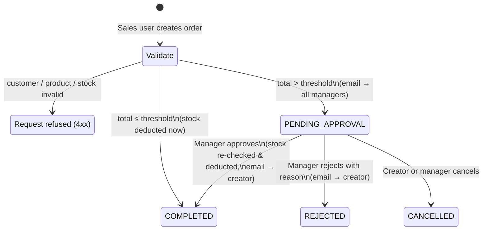
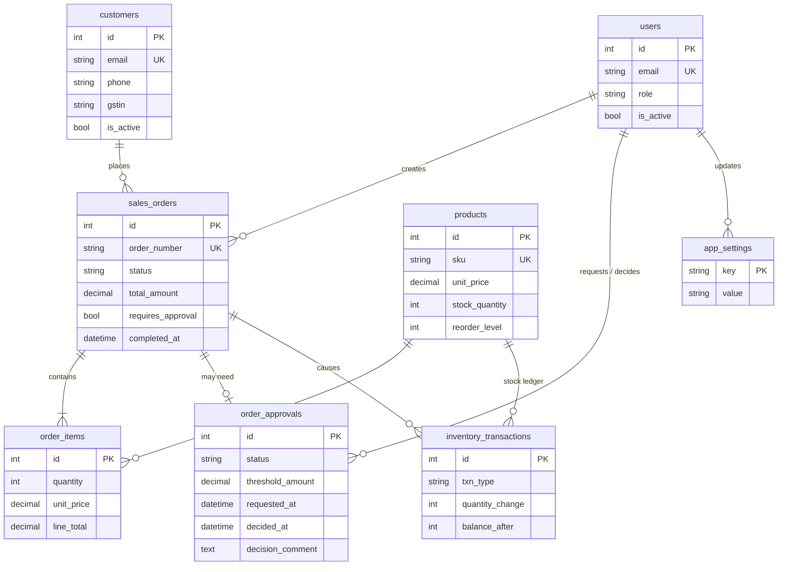

# Sales & Inventory Management System

A web application for managing products, customers and sales orders, with stock control and a **manager approval workflow** for high-value orders. Notifications are sent by email.

**Stack:** React 19 + TypeScript (Vite, Tailwind, TanStack Query, React Hook Form + Zod, Recharts) · FastAPI · Python 3.12 · SQLAlchemy 2 · Alembic · MySQL 8.4 · JWT auth · SMTP (Mailpit locally)

---

## Quick start

Requires Docker Desktop.

```bash
docker compose up --build
```

| What | URL |
|---|---|
| Web app | http://localhost:3000 |
| API docs (Swagger) | http://localhost:8000/api/docs |
| Email inbox (Mailpit) | http://localhost:8025 |
| MySQL | `localhost:3310` · user `bookxpert` / `bookxpert` · db `sales_inventory` |

On first start the API applies migrations and seeds demo data: 4 users, 6 customers, 12 products, and about 30 orders spread over the last four weeks. Two of those orders are still waiting for approval.

### Demo accounts

| Role | Email | Password |
|---|---|---|
| Manager | `manager@bookxpert.com` | `Manager@123` |
| Manager | `finance.manager@bookxpert.com` | `Manager@123` |
| Sales | `sales@bookxpert.com` | `Sales@123` |
| Sales | `sales2@bookxpert.com` | `Sales@123` |

The login page has buttons that fill these in.

To start again from a clean database: `docker compose down -v && docker compose up --build`.

---

## The approval workflow



Business rules:

- **Threshold.** Orders with a total strictly above the approval limit (₹50,000 by default) need approval. Managers can change the limit on the Settings page. Each approval record stores the limit that applied when it was raised, for audit.
- **Validation at creation.** The customer must exist and be active, every product must exist and be active, and there must be enough stock for every line. If the same product appears on two lines, they are merged.
- **Stock is reserved only on completion.** A pending order does not hold stock. At approval time the stock is **checked again**, because other orders may have used it in the meantime. If it's no longer available, approval fails with `409 INSUFFICIENT_STOCK` and the manager can reject the order instead.
- **Separation of duties.** A manager cannot approve or reject an order they raised; a different manager has to decide it. Rejecting requires a reason.
- **Prices are copied onto the order lines** when the order is created, so a later price change doesn't alter past orders.
- **Every stock change** (opening stock, sale, restock, adjustment) adds a row to `inventory_transactions` with the balance after the change. This makes the stock history fully auditable.

### Transactions and concurrency

Each command runs in a single database transaction (`app/services/order_service.py`):

1. The order row is locked with `SELECT … FOR UPDATE`. If two managers approve at the same time, the second one waits and then gets `409 INVALID_ORDER_STATE`.
2. Product rows are locked with `SELECT … FOR UPDATE` in **ascending id order**, so two orders that touch the same products can't deadlock. They are re-read under the lock (`populate_existing`) so the stock check uses the latest numbers.
3. Stock is deducted, ledger rows are written, the status and approval are updated, then `COMMIT`. Any error rolls the whole transaction back.
4. A `CHECK (stock_quantity >= 0)` constraint in MySQL is a last line of defence against overselling.

### Email

Emails are built while the request is running and sent **after the commit** using FastAPI `BackgroundTasks`. A slow or failed SMTP server never blocks the request or rolls back the order. Failures are logged. All user-entered text is HTML-escaped in the templates.

- **Approval required** goes to every active manager except the one who raised the order. It includes the order lines, total, limit and a link to the order.
- **Approved / Rejected** goes to the order's creator, with the manager's comment.

Locally, every email lands in Mailpit at http://localhost:8025. To send real emails (Gmail, for example), set these before running `docker compose up`:

```bash
export SMTP_HOST=smtp.gmail.com SMTP_PORT=587 SMTP_USE_TLS=true \
       SMTP_USERNAME=you@gmail.com SMTP_PASSWORD=<app-password> SMTP_FROM="Sales <you@gmail.com>"
```

---

## Architecture

```
backend/
  app/
    core/        config (pydantic-settings), DB session, JWT/bcrypt, error types + handlers
    models/      SQLAlchemy 2.0 typed models
    schemas/     Pydantic v2 request/response models (all validation lives here)
    services/    business logic: order workflow, stock, dashboard queries, email
    api/         routers (HTTP only, kept thin) + dependencies (auth, roles, pagination)
    seed.py      demo data, created through the real order service
  alembic/       migrations
  tests/         pytest: workflow, permissions, validation, stock re-check
frontend/
  src/
    api/         axios client (JWT interceptor, 401 → logout), typed endpoints
    auth/        AuthContext, route guards (RequireAuth / RequireManager)
    components/  layout + small UI kit (Button, Modal, Table, Badge, …)
    pages/       Dashboard, Orders, New order, Order detail, Approvals,
                 Products, Customers, Inventory log, Users, Settings
```

The routers only handle HTTP. Services hold the business rules and own the transaction. Schemas handle validation and serialisation. The React app proxies `/api` to FastAPI (nginx in Docker, the Vite dev server locally), so no CORS setup is needed in production.

### Database



- Money is stored as `DECIMAL(12,2)` and calculated with Python `Decimal`, never floats.
- Timestamps are stored in UTC; the API returns ISO 8601 with a `Z` suffix.
- Customers and products are soft-deleted (`is_active`) because past orders reference them.
- Foreign keys, status columns and dates used in filters are indexed.

### Roles

| Action | Sales | Manager |
|---|:-:|:-:|
| View dashboard, products, customers, orders, inventory log | ✓ | ✓ |
| Create / edit customers | ✓ | ✓ |
| Create orders, cancel own pending orders | ✓ | ✓ |
| Approve / reject orders (not their own) | | ✓ |
| Create / edit products, adjust stock | | ✓ |
| Deactivate customers, manage users, change approval limit | | ✓ |

The API enforces these rules; the UI also hides actions a user isn't allowed to take.

### Error format

Every error response has the same shape, so the UI can show field-level messages:

```json
{ "error": { "code": "INSUFFICIENT_STOCK",
             "message": "Insufficient stock: Dell Latitude 5440 Laptop (requested 30, available 19)",
             "details": [{ "product_id": 1, "sku": "LAP-DEL-5440", "requested": 30, "available": 19 }] } }
```

Codes: `VALIDATION_ERROR` (422, with a `field` for each problem), `UNAUTHORIZED` (401), `FORBIDDEN` (403), `NOT_FOUND` (404), `CONFLICT` / `INSUFFICIENT_STOCK` / `INVALID_ORDER_STATE` (409), `BUSINESS_RULE_VIOLATION` (422), `INTERNAL_ERROR` (500).

---

## API overview

All endpoints are under `/api/v1` and need `Authorization: Bearer <token>`, except login. The full interactive reference is at `/api/docs`.

| Method | Path | Notes |
|---|---|---|
| POST | `/auth/login` | `{email, password}` → JWT + user |
| GET | `/auth/me` | current user |
| GET/POST | `/products` | list (search, `low_stock`, pagination) / create (manager) |
| PATCH/DELETE | `/products/{id}` | update / deactivate (manager) |
| POST | `/products/{id}/stock-adjustments` | restock or adjust (manager) |
| GET/POST | `/customers` | list (search) / create |
| PATCH/DELETE | `/customers/{id}` | update / deactivate (manager) |
| GET/POST | `/orders` | list (status, search, `mine`, dates) / create |
| GET | `/orders/{id}` | detail with items + approval |
| POST | `/orders/{id}/approve` · `/reject` · `/cancel` | workflow actions |
| GET | `/approvals?status=PENDING` | approval queue (manager) |
| GET | `/inventory/transactions` | stock ledger |
| GET | `/dashboard/summary` | KPIs, 30-day trend, top products, low stock, recent orders |
| GET/PUT | `/settings`, `/settings/approval-threshold` | approval limit |
| GET/POST/PATCH | `/users` | user management (manager) |

---

## Running without Docker

```bash
# MySQL + Mailpit only
docker compose up -d db mailpit

# API (Python 3.11+)
cd backend
python -m venv .venv && source .venv/bin/activate
pip install -r requirements-dev.txt
cp .env.example .env
alembic upgrade head && python -m app.seed
uvicorn app.main:app --reload

# Web
cd frontend
npm install
npm run dev            # http://localhost:5174, proxies /api to :8000
```

## Tests

```bash
docker compose run --rm --no-deps api pytest -q
```

The tests use in-memory SQLite and a captured outbox, so they don't need MySQL or SMTP. They cover:
- small orders completing immediately and large orders waiting for approval
- the emails each step sends
- approval deducting stock and rejection leaving it alone
- stock being re-checked at approval
- deciding the same order twice
- role checks, including no self-approval
- validation error format
- threshold changes
